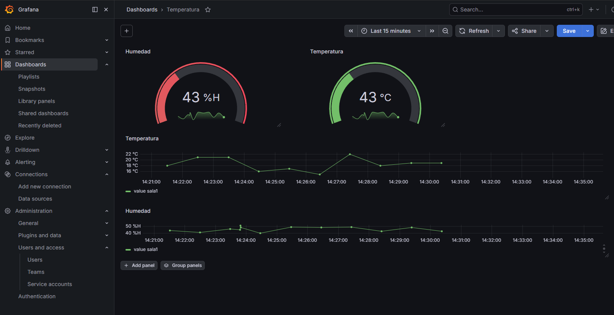
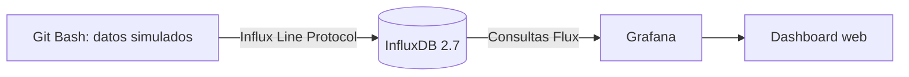

# Laboratorio de monitoreo IoT con Grafana e InfluxDB

Proyecto para aprender a desplegar Grafana e InfluxDB con Docker Compose, conectar ambas herramientas y construir manualmente un dashboard de temperatura y humedad a partir de datos ficticios.

> Los valores mostrados son simulados y no representan mediciones de sensores reales.



## Qué hice en este proyecto

- Desplegué Grafana OSS e InfluxDB 2.7 mediante Docker Compose.
- Conecté ambos contenedores utilizando una red de Docker.
- Configuré manualmente InfluxDB como datasource desde la interfaz de Grafana.
- Generé datos ficticios de temperatura y humedad desde Git Bash.
- Escribí consultas Flux para leer las series temporales.
- Construí manualmente indicadores y gráficos en un dashboard de Grafana.
- Separé las credenciales del archivo Compose para no publicarlas.

## Arquitectura



## Tecnologías

- Docker y Docker Compose
- Grafana OSS
- InfluxDB 2.7
- Flux
- Git Bash

## Puesta en marcha

### 1. Crear la configuración local

Copiá el archivo de ejemplo:

```bash
cp .env.example .env
```

Editá `.env` y reemplazá los valores ilustrativos. El archivo está ignorado por Git y no debe publicarse.

### 2. Crear la red de Docker

Este laboratorio utiliza una red externa para que Grafana pueda encontrar a InfluxDB por el nombre del servicio:

```bash
docker network create red-iiot
```

Si la red ya existe, Docker informará que no puede crearla nuevamente; se puede continuar con el siguiente paso.

### 3. Iniciar Grafana e InfluxDB

```bash
docker compose up -d
```

Comprobá el estado de los contenedores:

```bash
docker compose ps
```

- Grafana: [http://localhost:3000](http://localhost:3000)
- InfluxDB: [http://localhost:8086](http://localhost:8086)

## Configuración manual de Grafana

### 1. Añadir InfluxDB como datasource

En Grafana ingresé en **Connections → Data sources → Add data source → InfluxDB** y completé:

| Campo | Valor |
| --- | --- |
| Query language | Flux |
| URL | `http://influxdb:8086` |
| Organization | El valor de `INFLUXDB_ORG` |
| Token | El valor de `INFLUXDB_TOKEN` |
| Default bucket | El valor de `INFLUXDB_BUCKET` |

Después utilicé **Save & test** para verificar la conexión.

### 2. Generar los datos ficticios

Los datos se generaron con un bucle ejecutado directamente en Git Bash. La siguiente es una versión segura del mismo procedimiento: toma la configuración desde `.env` en lugar de escribir el token dentro del comando.

```bash
set -a
source .env
set +a

for i in {1..120}; do
  val_hum=$((40 + RANDOM % 15))
  val_temp=$((15 + RANDOM % 10))
  timestamp="$(date -d "$i minutes ago" +%s)000000000"

  docker exec -i influxdb influx write \
    --org "$INFLUXDB_ORG" \
    --bucket "$INFLUXDB_BUCKET" \
    --token "$INFLUXDB_TOKEN" \
    "humedad,sensor=sala1 value=${val_hum} ${timestamp}"

  docker exec -i influxdb influx write \
    --org "$INFLUXDB_ORG" \
    --bucket "$INFLUXDB_BUCKET" \
    --token "$INFLUXDB_TOKEN" \
    "temperatura,sensor=sala1 value=${val_temp} ${timestamp}"
done
```

El bucle crea 120 lecturas históricas de cada variable, separadas por un minuto.

### 3. Crear las consultas Flux

Desde **Dashboards → New dashboard → Add visualization** escribí una consulta para cada measurement.

Humedad:

```flux
from(bucket: "iiot-2")
  |> range(start: v.timeRangeStart, stop: v.timeRangeStop)
  |> filter(fn: (r) => r["_measurement"] == "humedad")
  |> filter(fn: (r) => r["_field"] == "value")
  |> aggregateWindow(every: v.windowPeriod, fn: last, createEmpty: false)
  |> yield(name: "last")
```

Temperatura:

```flux
from(bucket: "iiot-2")
  |> range(start: v.timeRangeStart, stop: v.timeRangeStop)
  |> filter(fn: (r) => r["_measurement"] == "temperatura")
  |> filter(fn: (r) => r["_field"] == "value")
  |> aggregateWindow(every: v.windowPeriod, fn: last, createEmpty: false)
  |> yield(name: "last")
```

Si se cambia `INFLUXDB_BUCKET` en `.env`, también se debe actualizar el nombre del bucket en estas consultas.

### 4. Construir el dashboard

El dashboard de la captura fue creado manualmente desde la interfaz y contiene:

- un indicador de humedad;
- un indicador de temperatura;
- una serie temporal de temperatura;
- una serie temporal de humedad.

Para visualizar las muestras históricas seleccioné un rango de tiempo que cubriera los datos generados y actualicé el dashboard.

## Estructura del repositorio

```text
.
├── .env.example
├── .gitignore
├── docker-compose.yml
├── docs/
│   └── images/dashboard-overview.png
├── LICENSE
└── README.md
```

## Seguridad

- Las credenciales reales se mantienen en `.env`.
- `.env` y `cred.txt` están excluidos mediante `.gitignore`.
- `.env.example` contiene únicamente valores ilustrativos.

## Detener el laboratorio

Para detener y retirar los contenedores creados por Compose:

```bash
docker compose down
```

